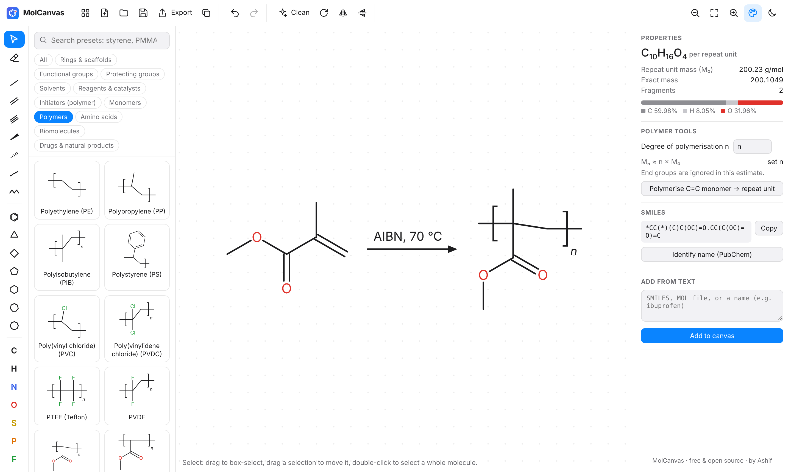

# MolCanvas

**A free, modern chemical structure editor for organic and polymer chemists.**
Native on macOS (Apple Silicon) and also runs in any browser.

### [▶ Try MolCanvas in your browser](https://ashif3hq.github.io/molCanvas/) · [Download for Mac](../../releases/latest)

No install or sign-up needed: the web version runs entirely in your browser.



MolCanvas is a lightweight, open-source alternative to commercial drawing tools. It focuses on
the things bench chemists do every day: drawing structures quickly, pulling common molecules
from a library, sketching polymer repeat units, and getting a clean figure into a paper,
slide deck or lab notebook.

## Features

- **Fast drawing:** single, double, triple, wedge, hash and wavy bonds; zig-zag chains; 3–8
  membered rings and benzene with automatic ring fusion; any element from the periodic table;
  charges; radicals; reaction, equilibrium, retrosynthesis and resonance arrows; text with automatic
  subscripts (`CH2Cl2` → CH₂Cl₂).
- **Ions and radicals:** cations and anions with formal charges, radicals (•), triplet and
  singlet carbenes/nitrenes, radical cations and anions. Each radical electron takes the place of
  a bond (CH₄ → CH₃•), the info bar names the species (tertiary carbocation, oxyl radical,
  triplet carbene…), and an optional lone-pair view draws non-bonding pairs. Radicals are kept in
  SMILES, MOL, CDXML and the 3D formats.
- **ChemDraw-style hotkeys:** hover an atom and press `N`, `O`, `S`, `F`, `L` (Cl), `B` (Br)… (`+`, `-` for charge, `.` for a radical)
  to change it; hover a bond and press `1`, `2`, `3` to set its order. Type a group such as
  `OMe`, `CO2H`, `Boc`, `Ph` or `TBS` with the text tool to expand it.
- **350+ presets**, all validated in CI:
  - 72 monomers (vinyl, acrylates, methacrylates, lactones, lactide, epoxides, diisocyanates,
    diacids, diamines, dianhydrides, conducting-polymer monomers…)
  - 60 polymer repeat units with proper brackets and *n* (PE, PP, PS, PVC, PTFE, PMMA, PNIPAM,
    PEG, PLA, PCL, PET, PC, nylon-6,6, Kevlar, Kapton, PEEK, PDMS, P3HT, PEDOT, cellulose…)
  - polymerisation initiators, RAFT agents and ATRP ligands
  - functional groups and protecting groups that attach to the atom you click
  - rings and scaffolds, solvents, reagents, amino acids, biomolecules and common drugs
- **Polymer tools:** turn any vinyl monomer into its repeat unit in one click, draw your own
  repeat units with the `*` end tool, set the degree of polymerisation and get Mₙ ≈ n × M₀.
- **Live properties:** formula, molecular weight, exact mass, elemental analysis, cLogP, TPSA,
  H-bond donors/acceptors, rotatable bonds and stereocentres, for the whole drawing or the
  selection.
- **Solubility parameters:** Hansen δD / δP / δH (Hoftyzer–Van Krevelen) and Hildebrand δ
  (Fedors) by group contribution, for molecules and polymer repeat units, with the groups
  counted shown and an optional density to use V = M/ρ. Structures outside the group tables
  are refused rather than guessed.
- **Molecular modelling:** copy a 3D MOL block (explicit H, MMFF94s+ minimised) to paste into
  Avogadro, Chem3D and similar programs, or export 3D SDF, MOL2 (SYBYL types), PDB and XYZ.
- **ChemDraw files:** open and save `.cdxml`. Abbreviations such as OMe, Boc or OTBS are expanded,
  aromatic bonds are kekulised, wedges, polymer (SRU) brackets, reaction arrows, + signs and text
  come across, and anything MolCanvas cannot represent (curved arrows, shapes, query atoms) is listed
  in the info bar rather than changed silently. Saved files use ChemDraw's ACS 1996 style and mark
  reactants and products so ChemDraw treats them as a reaction. Pasting CDXML text works too.
- **Import & export:** SMILES and MOL (V2000 and V3000) in and out, PNG (high resolution, white or transparent),
  SVG, and copy-as-image for Word, PowerPoint and Keynote. Name → structure and structure →
  IUPAC name via PubChem (optional, needs internet).
- **Modern UI:** light and dark mode, trackpad pan and pinch-zoom, unlimited undo, autosave.

## Download (macOS)

Grab the latest `.dmg` from the [Releases](../../releases) page (or from the **Actions** tab:
open the latest *macOS app* run and download the `MolCanvas-macOS-arm64` artifact).

The app is ad-hoc signed but not notarised by Apple yet, so macOS warns you the first time:

1. Open the `.dmg` and drag **MolCanvas** into **Applications**.
2. In Applications, right-click MolCanvas and choose **Open**, then **Open** again.
3. On macOS 15 (Sequoia) or newer, if there is no **Open** button: click **Done**, then go to
   **System Settings → Privacy & Security** and click **Open Anyway** next to the MolCanvas message.

Every release also carries these steps as `How-to-install-MolCanvas-on-Mac.txt`
(full guide: [docs/INSTALL-macOS.md](docs/INSTALL-macOS.md)).

If macOS says the app **"is damaged and can't be opened"** (this happens with some browsers,
which mark downloads as quarantined), remove the quarantine flag once in Terminal and open it
normally:

```sh
xattr -cr /Applications/MolCanvas.app
```

## Build from source

Requirements: Node.js 20+, and for the desktop app [Rust](https://rustup.rs) plus the Xcode
command line tools (`xcode-select --install`).

```sh
npm install
npm run dev          # web version at http://localhost:1420
npm run app:dev      # desktop app with hot reload
npm run app:build    # builds MolCanvas.app and a .dmg in src-tauri/target/release/bundle
npm run check:presets  # validates every preset structure
npm run check:solubility  # group-contribution sums against hand-worked values
npm run check:export   # MOL V2000/V3000 round trips and 3D SDF/MOL2/PDB/XYZ output
npm run check:cdxml    # ChemDraw CDXML round trips and a ChemDraw-written test file
npm run check:radicals # radicals, carbenes and ions: valence, info bar, every export format
```

## How it works

| Layer | What it does |
| --- | --- |
| `src/model.ts` | Document model: atoms, bonds, arrows and text in screen coordinates |
| `src/geometry.ts` | Where new bonds, rings, chains and templates go; polymer layout |
| `src/render.ts` | SVG renderer shared by the canvas, thumbnails and export |
| `src/editor.ts` | Tools, hit testing, selection, undo/redo, clipboard, pan/zoom |
| `src/chem.ts` | Chemistry via [OpenChemLib](https://github.com/cheminfo/openchemlib-js): valence, rings, SMILES/MOL, formula, properties |
| `src/cdxml.ts` | ChemDraw CDXML reader and writer |
| `src/solubility.ts` | Hansen and Hildebrand solubility parameters by group contribution |
| `src/modeling.ts` | 3D conformers (OpenChemLib + MMFF94s+) and SDF/MOL2/PDB/XYZ writers |
| `src/presets.ts` | The preset library (SMILES, laid out at runtime) |
| `src-tauri/` | The [Tauri](https://tauri.app) desktop shell (small native app using the system WebKit) |

The macOS build runs on GitHub's Apple Silicon runners (`.github/workflows/macos.yml`), and the
web version is published to the `gh-pages` branch and served by GitHub Pages
(`.github/workflows/pages.yml`).

## Roadmap

- Reaction schemes with atom mapping and reagent placement
- Copolymers (random/block/alternating notation) and end groups
- ChemDraw binary `.cdx` files
- InChI / InChIKey, NMR shift prediction
- Signed and notarised macOS releases

## Author

Created by **Ashif**. Released under the [MIT License](LICENSE).
